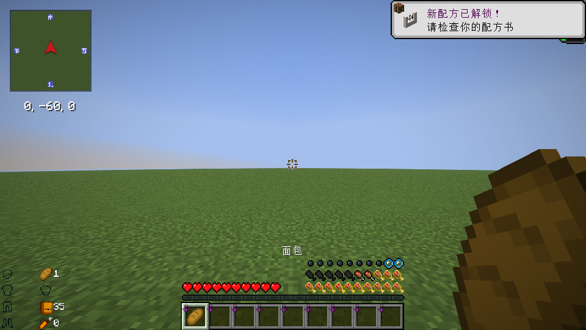

# Farmer’s Delight: Flavorful Wonders

A Fabric food-effects add-on for Minecraft 26.3 and Farmer’s Delight Refabricated.

Version [1.0.1](https://github.com/YMXKNebula/flavorful-wonders/releases/tag/v1.0.1) rebalances food durations around their main uses, preparation and per-serving costs. Semi-processed food remains centred on 3/7 of its reference meal, with small complexity adjustments. Effect combinations, levels and gameplay mechanics are unchanged. Melon popsicle healing chance increases from 25% to 50%; see the [changelog](docs/CHANGELOG.md).

427 foods receive 648 fixed effect entries using 21 original effects and 20 vanilla positive effects. Combine different meals for mining, building, exploration and combat. Raw ingredients receive no added effects.

Requires Java 25, Fabric Loader 0.19.5+, Fabric API and Farmer’s Delight Refabricated. Install the release JAR on both client and server. Nine Delight add-ons and AppleSkin are optional; see the [Chinese README](README.md) for the full list, configuration and gameplay notes.

The 1.0.0 release was checked with 36 server tests, 439 mapped foods and a 136-mod client pack. Version 1.0.1 passes nine settlement checks and 37 GameTests in both the core and nine-add-on environments on Loader 0.19.5; the latter consumes all 439 mapped foods. Client checks pass with the add-ons and the retained 136-mod test pack. Remote multiplayer, every mod combination, long-term balance and custom client/server configuration differences are not fully tested.

Existing entries in `config/baiweiqixiao/food_overrides.json` continue to replace the complete default entry for each listed food, including the new 1.0.1 values. Review your overrides when upgrading.

Source, original icons and mappings are MIT-licensed. Minecraft and third-party mod binaries are not distributed here. See [building instructions](docs/BUILDING.md).
