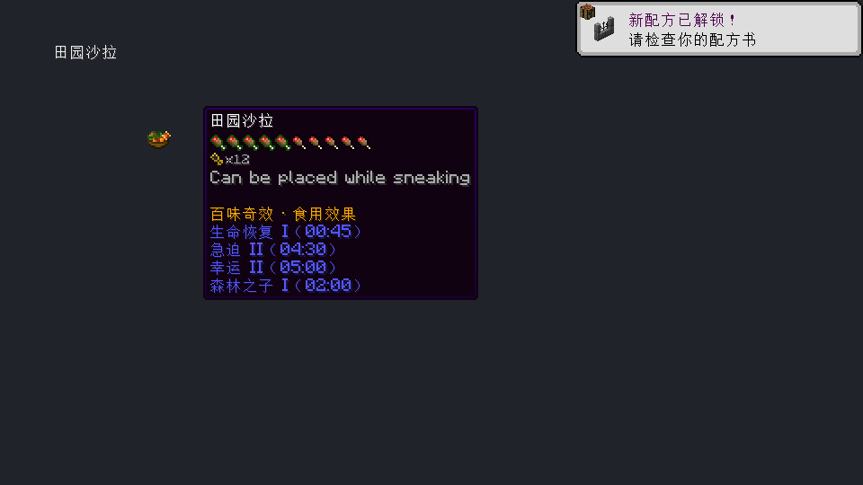
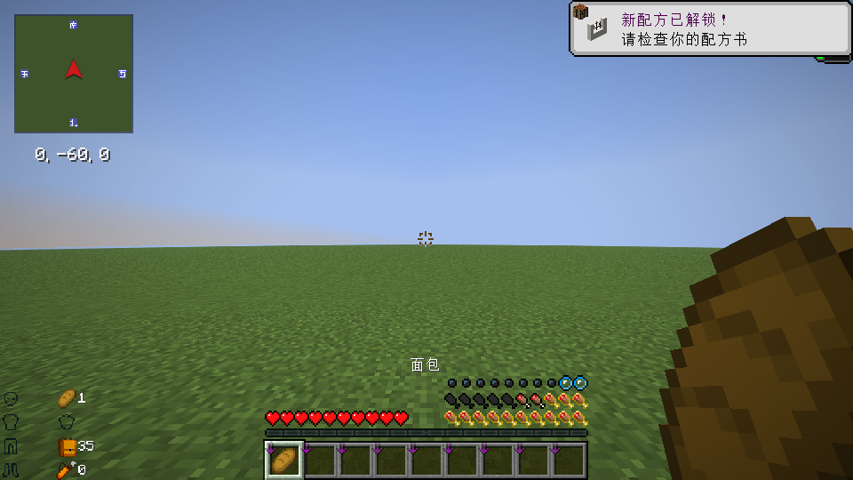

# 农夫乐事：百味奇效

Farmer’s Delight: Flavorful Wonders · Minecraft 26.3 · Fabric

当前版本[1.0.1](https://github.com/YMXKNebula/flavorful-wonders/releases/tag/v1.0.1)。按食品主副用途、工序和每份成本重新平衡时长；简单半加工略短、复杂料理的主效果适当增强，半加工总体仍以成品3/7为参照。效果种类、等级和核心机制保持，西瓜冰棍的治疗Ⅰ触发率由25%提高到50%。见[更新记录](docs/CHANGELOG.md)。

做好的饭，除了填饱肚子，也能派上别的用场。

百味奇效为农夫乐事和九个料理附属添加固定的食物效果。带几种不同的饭出门，可以搭配出采矿、建造、探索或战斗需要的能力。原料不新增效果，半加工品和成品各有用途；同一种食物的效果始终一致。

## 游戏里是什么样

悬停食物就能看到效果、等级和时间。保留的原生效果与新增效果一起列出，瞬时效果会单独标明。

大胃袋会把饥饿值和饱和度上限提高到40，饥饿条增加一排，也支持 AppleSkin 的饱和度与持食预览。

## 能做什么

- 427种食物配置了648条新增效果，包含21种原创效果和20种原版正面效果。
- 游刃有余免耐久，轻如鸿毛提供自由飞行，嗜血习性按实际伤害的50%回血。
- 满饥饿值也能继续吃正常食物。营养、容器、食用动画和原有特殊功能保留。
- 部分食物移除了滋养，部分主餐仍然保留。吃掉已移除滋养的食物，不会清除身上此前获得的滋养。
- 随心配范围内的生物会冒原版爱心，包括玩家和Boss。繁殖仍保留物种条件和冷却。
- 取消低饥饿值禁跑：饥饿值≤6且奔跑时，每80游戏刻额外受到1点饥饿伤害；饥饿值为0时可与原生饥饿伤害叠加，保留难度限制。

## 安装

需要 Minecraft **26.3**、Java **25**、Fabric Loader **0.19.5及以上**、Fabric API，以及 Farmer’s Delight Refabricated（`farmersdelight`）。

从 [Releases](https://github.com/YMXKNebula/flavorful-wonders/releases) 下载JAR，放进实例的 `mods` 文件夹。服务器和客户端都需要安装。更新时先关闭游戏和服务器，替换旧JAR，再重新启动。

支持的可选附属：Rustic Delight、Spanish Delight、Easter’s Delight、More Delight、Ube’s Delight、Colonial Delight、Crabber’s Delight、Delightful、My Nether’s Delight。装哪个就启用哪个；附属本身要求的依赖照常安装。AppleSkin也可选。

## 调整食物效果

在 `config/baiweiqixiao/food_overrides.json` 中按物品ID覆盖配置。列出的食品条目整体替换，其他食品使用默认值。已有覆盖条目会继续优先于1.0.1默认值，升级时请自行核对。写法见 [配置说明](docs/CONFIGURATION.md)。

新陈代谢保留原版快、慢两档，两档分别加速到两倍；饱和度耗尽后回血会变慢。大胃袋结束时，超过正常上限的资源会立即收回。

## 兼容情况

1.0.0已在Fabric Loader 0.19.5上通过36项服务端自动测试，检查了439种映射食品的食用流程；也在包含136个原始模组的整包客户端中检查了进世界、提示框、双排饥饿条和AppleSkin显示。

1.0.1已通过9项结算检查，并在Loader 0.19.5的核心及九附属环境分别通过37项GameTest，九附属环境实际食用了439种映射食品。新增检查区分了西瓜冰棍50%与蜂蜜曲奇25%的治疗触发率；九附属客户端及保留的136模组整包测试副本均通过新时长、提示与HUD检查。

这些检查不覆盖所有模组组合。真实远程多人、长期平衡、Boss专属AI对恐吓的影响，以及客户端和服务端使用不同食物配置时的提示同步，仍需继续验证。遇到问题请在 [Issues](https://github.com/YMXKNebula/flavorful-wonders/issues) 附上日志、食物ID和复现步骤。

## 源码与许可

[构建方法](docs/BUILDING.md) · [English](README.en.md)

项目源码、原创图标和食物映射采用 [MIT许可证](LICENSE)。仓库不包含Minecraft或第三方模组JAR。截图中的游戏内容及其他模组内容归各自作者所有。
